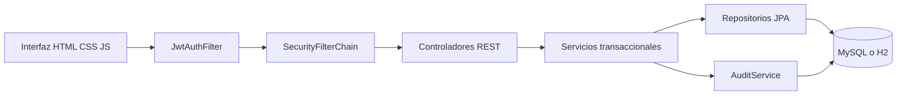
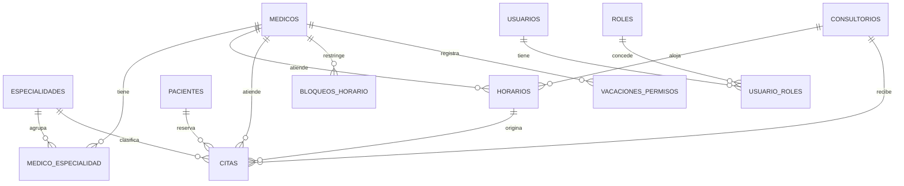

# Desarrollo e integración de Aurora

## Objetivo y punto de partida

Se transformó el backend del repositorio MED-ESPECIALIDADES-CON-REP en una aplicación web de gestión ambulatoria que permite demostrar persistencia, relaciones, reglas de agenda, autenticación JWT, autorización y auditoría. El punto de partida es el commit `1cd2e119ed29d126f777a4e2b75f7975d2a08a76`; el trabajo está en la rama `codex/clinica-integral`.

La aplicación original contenía médicos, especialidades, horarios, consultorios, bloqueos y un reporte JSON. No contenía interfaz web, pacientes, citas, autenticación ni administración completa de ausencias. Sus vacíos impedían mostrar el recorrido completo indicado en las fotografías.

El archivo GLAB-S09-RCOELLO-2026-01-3.docx es una guía de laboratorio JWT con actividades de análisis. No contiene una tabla de ponderaciones de calificación. Se cubrieron sus capacidades y casos observables; no se inventaron porcentajes ni una nota garantizada. La indicación del documento de trabajo individual se trató como contexto del laboratorio; el guion responde al pedido actual de una exposición de tres integrantes.

## Correspondencia con los requisitos recibidos

| Evidencia solicitada | Implementación | Demostración |
|---|---|---|
| Java | Código Java 17; ejecución verificada con JDK 21 | Entidades, servicios y pruebas |
| Hibernate y clases | Entidades JPA y repositorios Spring Data | Mostrar relaciones y tablas |
| Base de datos | MySQL configurable; H2 persistente para demo y en memoria para pruebas | Crear un registro y comprobar persistencia |
| Pacientes | Catálogo con DNI único, nacimiento y contacto | Crear/editar un paciente |
| Citas | Reserva, reprogramación, cancelación y atención | Reservar una franja y comprobar que deja de estar disponible |
| Doctor y especialidades | Relación muchos a muchos | Editar asociaciones de un médico |
| Horario | Turnos semanales, duración, consultorio y excepciones | Rechazar un cruce y registrar un permiso |
| Auditoría | Usuario, acción, fecha/hora, tabla, ID y detalle | Localizar un cambio después de ejecutarlo |
| Roles y usuarios | ADMIN, MODERATOR, USER, estados y sesiones revocables | Usuario sin privilegios recibe 403 |
| JWT | JJWT, filtro Bearer, firma HS256, emisor, expiración y versión | Token válido, alterado, vencido y ausente |
| Contraseñas seguras | BCrypt; no se serializan ni auditan hashes | Ver columna de contraseña sin exponerla en JSON |
| Casos del laboratorio | Rutas públicas y protegidas, panel JWT y Postman | Seis casos de la guía |
| Exposición | Guion técnico para tres integrantes | docs/EXPOSICION.md |

## Correcciones de los errores originales

1. **Codificación:** `application.properties` y las fuentes se normalizaron a UTF-8. La compilación ya no depende de una sobrescritura a Windows-1252.
2. **Duraciones inválidas:** la entrada acepta de 5 a 240 minutos y nunca más que la longitud del turno. Los registros antiguos inválidos no generan franjas.
3. **Bucle al cruzar medianoche:** los intervalos se calculan con un límite numérico de minutos. Los turnos pertenecen a un único día y el final debe ser posterior al inicio.
4. **Validación prematura del médico:** los horarios reciben DTO sin una entidad `medico` en el cuerpo. El médico se obtiene de la ruta.
5. **Cruces de agenda:** se verifican médico y consultorio al crear, editar, reactivar y reasignar horarios.
6. **Disponibilidad incompleta:** se consideran citas no canceladas, permisos vigentes, bloqueos vigentes, horarios activos, estado del médico y consultorio, y horas pasadas.
7. **Duplicados:** se revisan CMP, DNI, código de consultorio y nombre de especialidad; la base también conserva restricciones únicas para las identidades principales.
8. **Errores de API:** respuestas consistentes para validación, formato, 404, conflictos, autenticación y autorización.
9. **Escritura de campos internos:** los cuerpos usan DTO y no pueden sobrescribir un registro enviando su ID en una solicitud de creación.
10. **Pruebas:** se sustituyó la prueba vacía de contexto por escenarios de integración de seguridad y negocio.

## Arquitectura

La interfaz se sirve desde Spring Boot y consume la API del mismo origen. No necesita Node, CDN ni una compilación frontend para funcionar. Los datos visibles proceden de la API; los indicadores no están simulados.

`ClinicService` agrupa los casos de uso de agenda y catálogos para que compartan validaciones transaccionales. `UserService` gestiona cuentas, `AuditService` registra cambios y las clases de `security` se ocupan del JWT. Los antiguos servicios parciales se sustituyeron; no se conservó una segunda ruta de escritura que eludiera las reglas nuevas.

## Modelo relacional

La auditoría conserva un usuario textual y referencias lógicas de tabla/registro para que el historial siga siendo legible. `agenda_lock` contiene una fila de coordinación, independiente del modelo de pacientes.

## Reglas de negocio

- La cita exige paciente, médico y especialidad activos y una asociación vigente entre médico y especialidad.
- Solo se puede reservar una franja completa de un horario válido con consultorio disponible.
- Un médico, consultorio o paciente no puede ocupar dos citas superpuestas.
- Todas las mutaciones de agenda adquieren un bloqueo pesimista de una fila común en la base. Dos solicitudes simultáneas se procesan en orden y vuelven a comprobar disponibilidad dentro de la transacción.
- Cancelar libera el cupo y conserva la cita y su motivo de cancelación.
- Reprogramar cambia la cita confirmada y libera el intervalo anterior.
- Una cita futura no se puede marcar atendida. Las citas atendidas y canceladas no se reprograman.
- Desactivar un recurso, modificar un turno o añadir una ausencia no puede dejar citas futuras confirmadas sin atención.
- Un bloqueo o permiso cancelado no afecta a disponibilidad.
- Las franjas que no completan la duración al final de un turno no se ofrecen.
- Los horarios no cruzan medianoche; si se requiere atención nocturna, se modelan turnos separados por día.
- Se conserva el historial mediante cambios de estado, sin borrado físico por la API.

El bloqueo global simplifica la consistencia y funciona entre instancias que comparten base de datos. Para un volumen hospitalario elevado convendría coordinar por recurso y mejorar las consultas; la solución actual prioriza corrección y claridad académica.

## Seguridad y diferencias respecto al ejemplo de la guía

Se implementaron `JwtUtils`, `JwtAuthFilter`, `UserDetailsServiceImpl`, `SecurityConfig`, `AuthController`, entidades de usuario/rol y DTO de entrada. JJWT se fijó en 0.12.6 con su API moderna; se mantuvo Spring Boot 4.1.1 del proyecto.

El filtro valida firma, emisor, expiración y versión del token. Después consulta el estado y los roles actuales del usuario. `SecurityContextHolder` contiene la autenticación de la solicitud. La API es stateless: no crea una sesión HTTP de autenticación. Se desactiva CSRF para esta API porque la credencial se envía explícitamente en `Authorization: Bearer` y no en cookies automáticas.

El navegador conserva el token en `sessionStorage`, lo elimina al cerrar sesión y no lo imprime en pantalla. La versión almacenada en usuario permite invalidarlo al cerrar sesiones, cambiar contraseña o modificar accesos. Se incluye una política CSP y se escapa el contenido dinámico antes de construir la interfaz.

Se corrigieron dos riesgos del ejemplo académico:

- `/api/test/all` es realmente pública mediante una regla explícita.
- El registro público no acepta privilegios solicitados por el cliente: siempre crea USER inactivo, pendiente de aprobación. ADMIN administra accesos desde una ruta protegida.

Las cuentas y el secreto conocidos existen exclusivamente para demostración. El perfil normal necesita un secreto externo. BCrypt impone un máximo de 72 bytes para evitar contraseñas truncadas. Los hashes y versiones de sesión no aparecen en las respuestas JSON.

## Auditoría

Cada cambio exitoso guarda usuario, acción, fecha/hora UTC, tabla, ID y descripción sin secretos. La interfaz presenta la hora de Lima. Los cambios de dominio y su registro de auditoría se guardan en la misma transacción: si la operación falla, no queda un evento que afirme falsamente que se completó. Los inicios de sesión correctos y cierres también quedan registrados.

La tabla es de solo lectura desde la API y se consulta con paginación. No se presenta como una bitácora criptográficamente inmutable ni como un registro completo de intentos fallidos: esos controles requerirían una capa adicional de seguridad y monitoreo.

## Interfaz

Se creó una identidad visual denominada Aurora, con colores verde profundo y salvia, panel lateral, tarjetas, tablas legibles y formularios modales. La navegación se adapta a pantallas pequeñas. Las vistas muestran carga, errores, vacíos y confirmación de operaciones; los botones no autorizados se ocultan, pero la protección efectiva permanece en el servidor.

El resumen diario, filtros por fecha y estado, búsqueda de catálogos, paginación visual, selección de franjas y exportación CSV permiten realizar una demostración real. Los CSV neutralizan prefijos que podrían interpretarse como fórmulas de hoja de cálculo.

## Verificación y entrega

Consultar `docs/VERIFICACION.md` para los resultados finales y el alcance de cada comprobación. La colección Postman facilita repetir los casos fuera de la interfaz. `docs/EXPOSICION.md` distribuye el contenido entre los tres integrantes y aporta un recorrido reproducible, sin inventar nombres ni resultados personales.

## Trabajo posterior si se convierte en un producto

Antes de operar con información real: migraciones Flyway/Liquibase, restricción por profesional o área, cifrado en tránsito, respaldo/restauración, límites de intentos, monitoreo, revisión de privacidad, pruebas de carga y consultas paginadas desde el servidor para todos los catálogos. La paginación actual de catálogos es visual; la auditoría sí pagina desde la base. No se promete la escalabilidad de un hospital grande con esta primera versión.

## Fuentes técnicas consultadas

- [JJWT, documentación del proyecto](https://github.com/jwtk/jjwt).
- [Spring Security, DaoAuthenticationProvider](https://docs.spring.io/spring-security/reference/servlet/authentication/passwords/dao-authentication-provider.html).
- [Java, propiedades de red y sockets temporales](https://docs.oracle.com/en/java/javase/17/docs/api/java.base/java/net/doc-files/net-properties.html).
