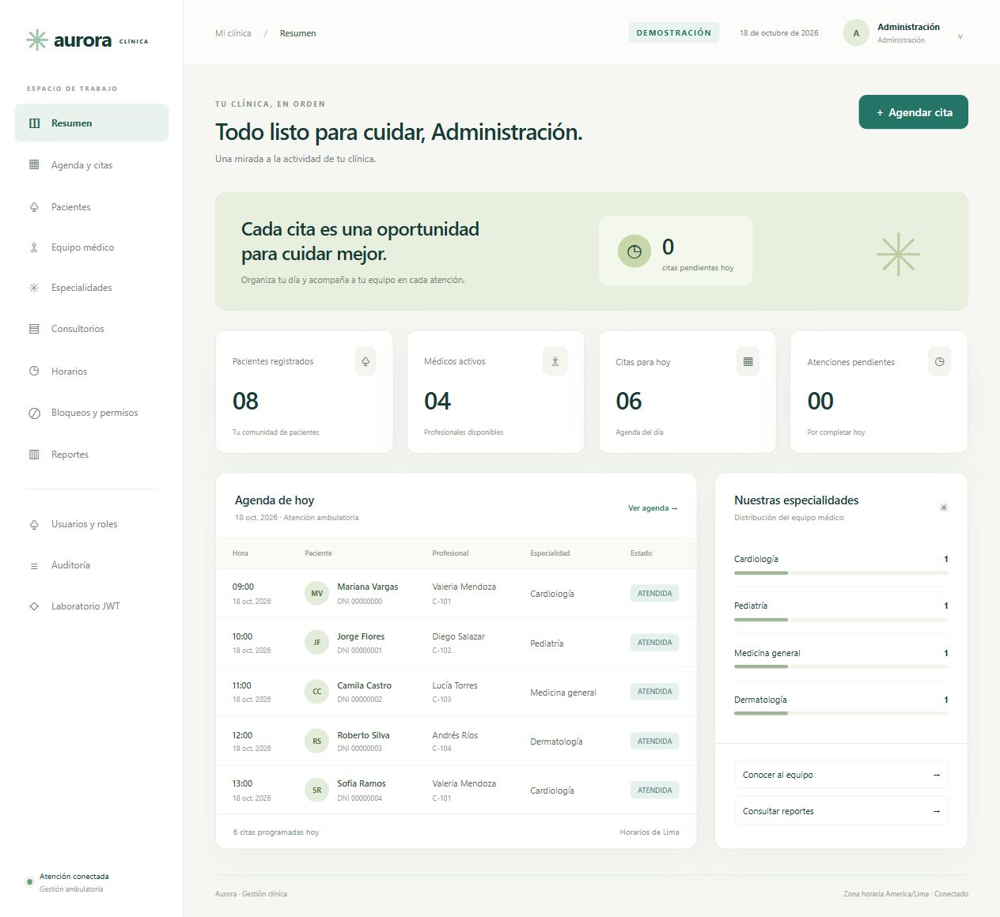

# Aurora · Gestión clínica

Aplicación académica de atención ambulatoria con **Java, Spring Boot, Hibernate/JPA, base de datos relacional, JWT, roles y auditoría**. Integra una interfaz web en español y el recorrido paciente → cita → médico → especialidad → horario → consultorio.



## Inicio rápido en Windows

1. Instala un **JDK 17 o 21**. Se requiere internet en la primera compilación para descargar dependencias Maven.
2. Ejecuta `INICIAR-DEMO.cmd` desde la raíz del proyecto.
3. Espera el mensaje `Started MedicosApplication` y abre **http://localhost:8080**.
4. Usa uno de los accesos de demostración de la pantalla inicial.

El script compila y ejecuta las pruebas si todavía no existe el JAR. Después de cambiar código, reconstruye:

Detén primero la aplicación con `Ctrl+C`; Windows no permite reemplazar el JAR que está en uso.

```powershell
.\scripts\Start-Aurora.ps1 -Mode demo -Rebuild
```

Si PowerShell bloquea el script por la política del equipo, el lanzador CMD aplica la autorización solo al proceso que ejecuta este script. No cambia la política global. También puedes ejecutar Maven y Java manualmente:

```powershell
$env:JAVA_HOME = 'C:\Program Files\Java\jdk-21.0.12' # Ajusta a tu JDK
.\mvnw.cmd -B package
& "$env:JAVA_HOME\bin\java.exe" -jar target/medicos-1.0.0.jar --spring.profiles.active=demo
```

Si aparece `Unable to establish loopback connection` en Windows, utiliza el lanzador incluido: activa el fallback TCP del JDK para evitar el problema de sockets locales del entorno. La ruta temporal indicada deliberadamente no existe; no debes crearla.

### Cuentas exclusivas de demostración

| Correo | Contraseña | Rol |
|---|---|---|
| admin@aurora.demo | AuroraAdmin2026! | ADMIN |
| recepcion@aurora.demo | AuroraRecepcion2026! | MODERATOR |
| consulta@aurora.demo | AuroraConsulta2026! | USER |

El perfil `demo` usa H2 **persistente en disco**, en `data/aurora.mv.db`. Los cambios sobreviven a los reinicios. Incluye cuatro profesionales, cuatro especialidades, cuatro consultorios, ocho pacientes y citas ficticias. Los datos se insertan únicamente al encontrar los catálogos vacíos; las fechas iniciales corresponden al primer arranque. Para la exposición de base de datos utiliza la configuración MySQL siguiente.

## Ejecutar con MySQL

Se utiliza **hospital_academico**, una base nueva, para no modificar automáticamente la base original `hospital_db`. No se migran los datos originales sin una revisión previa.

**Si usas XAMPP:** el botón MySQL puede iniciar MariaDB 10.4. Para ese motor usa el perfil `xampp`, que incorpora su controlador y dialecto compatibles:

```powershell
# Inicia primero MySQL en el panel XAMPP.
$env:DB_URL = 'jdbc:mariadb://localhost:3306/hospital_academico?createDatabaseIfNotExist=true'
$env:DB_USER = 'root'
$env:DB_PASSWORD = ''
# Configura JWT_SECRET, ADMIN_EMAIL y ADMIN_PASSWORD como se explica debajo.
.\scripts\Start-Aurora.ps1 -Mode xampp
```

El perfil `mysql` siguiente está destinado a **Oracle MySQL 8 o posterior**. No intercambies el prefijo `jdbc:mysql` y `jdbc:mariadb` entre perfiles.

```powershell
$env:DB_URL = 'jdbc:mysql://localhost:3306/hospital_academico?createDatabaseIfNotExist=true&serverTimezone=America/Lima'
$env:DB_USER = 'root'             # Ajusta al usuario de tu MySQL local
$env:DB_PASSWORD = ''            # Ajusta según tu instalación
$env:JWT_SECRET = [Convert]::ToBase64String([System.Security.Cryptography.RandomNumberGenerator]::GetBytes(48))
$env:ADMIN_EMAIL = 'admin@clinica.local'
$env:ADMIN_PASSWORD = 'UsaUnaClavePropia2026!'
.\scripts\Start-Aurora.ps1 -Mode mysql
```

Con Windows PowerShell 5.1, genera el secreto de esta forma si `GetBytes(48)` no está disponible:

```powershell
$auroraBytes = New-Object byte[] 48
$auroraRng = [System.Security.Cryptography.RandomNumberGenerator]::Create()
$auroraRng.GetBytes($auroraBytes)
$env:JWT_SECRET = [Convert]::ToBase64String($auroraBytes)
$auroraRng.Dispose()
```

Conserva el secreto en un almacén privado de configuración entre reinicios; cambiarlo invalida los tokens. El archivo `.env.example` es una referencia: Spring Boot no lo carga automáticamente. El primer inicio necesita `ADMIN_EMAIL` y `ADMIN_PASSWORD`; después se conserva la cuenta almacenada. La contraseña inicial no se reescribe en cada arranque.

Para una exposición con datos ficticios **en MySQL**, puedes activar `--app.demo=true` sin activar el perfil `demo`, pasando el argumento al JAR. Así se conserva la conexión MySQL y se insertan las cuentas y los datos de ejemplo en una base vacía. No lo utilices con datos reales.

```powershell
& "$env:JAVA_HOME\bin\java.exe" '-Djdk.net.unixdomain.tmpdir=C:/__aurora_no_unix_socket_dir__' -jar target/medicos-1.0.0.jar --app.demo=true --server.address=127.0.0.1
```

Para XAMPP agrega `--spring.profiles.active=xampp` al último comando y conserva `DB_URL` con el prefijo `jdbc:mariadb`. El esquema de referencia de la instancia verificada está en [docs/schema-mariadb.sql](docs/schema-mariadb.sql); no contiene datos ni contraseñas y no reemplaza un sistema de migraciones.

## Qué puedes hacer

- Consultar el resumen diario con indicadores derivados de la base de datos.
- Crear y editar pacientes, médicos, especialidades y consultorios; activar o desactivar registros.
- Asociar varias especialidades a un médico y reemplazar sus asociaciones.
- Configurar horarios semanales y detectar cruces de médico o consultorio.
- Reservar citas en franjas válidas, reprogramar, cancelar y registrar atención.
- Crear bloqueos por horas y vacaciones/permisos; cancelarlos conservando el historial.
- Revisar reportes por especialidad y actividad por profesional; exportar CSV compatible con Excel.
- Crear usuarios, asignar roles, activar solicitudes y revocar sesiones.
- Consultar la auditoría de cambios y ejecutar pruebas JWT en un panel dedicado.

## Permisos

| Acción | ADMIN | MODERATOR (recepción) | USER (consulta) |
|---|---:|---:|---:|
| Consultar agenda, catálogos y reportes | Sí | Sí | Sí |
| Registrar/editar pacientes y gestionar citas | Sí | Sí | No |
| Administrar profesionales, horarios y ausencias | Sí | No | No |
| Administrar usuarios y consultar auditoría | Sí | No | No |
| Cambiar contraseña propia y cerrar sesión | Sí | Sí | Sí |

USER es un rol interno de consulta, no un portal de pacientes. El registro público crea una cuenta **inactiva** con USER; un administrador debe activarla. Los permisos se aplican en el backend, aunque se invoque la API fuera del navegador.

## Documentación para el equipo

- [Distribución del equipo en PDF](docs/Distribucion_equipo_Aurora.pdf): responsabilidades de Jose Contreras, Sheila Aguirre y Dario Maza, con cinco minutos de exposición por integrante.

- [PROYECTO.md](PROYECTO.md): cambios, decisiones, modelo de datos y correspondencia con la guía y las fotos.
- [docs/EXPOSICION.md](docs/EXPOSICION.md): guion para tres integrantes, seis casos de seguridad, observaciones y conclusiones.
- [docs/API.md](docs/API.md): rutas, solicitudes, respuestas y compatibilidad.
- [docs/VERIFICACION.md](docs/VERIFICACION.md): pruebas ejecutadas y límites verificados.
- [docs/Aurora.postman_collection.json](docs/Aurora.postman_collection.json): colección para Postman.

## Verificar y empaquetar

```powershell
.\mvnw.cmd -B test
.\mvnw.cmd -B package
```

Las pruebas utilizan H2 en memoria y el perfil `test`. No modifican la base MySQL ni la demostración persistente. GitHub Actions ejecutará `verify` cuando se publique el código y se habiliten los workflows.

## Alcance real

Es un sistema funcional de **gestión administrativa ambulatoria para una demostración académica**. No incluye historia clínica, diagnósticos, recetas, facturación, pagos, notificaciones externas ni un portal individual de pacientes. No procesa decisiones clínicas.

Antes de usarlo con pacientes reales se requieren revisión de privacidad y seguridad, HTTPS, límites de intentos de acceso, copias de seguridad, migraciones versionadas, monitoreo y controles de acceso más granulares. Actualmente el esquema se mantiene con `ddl-auto=update`, apropiado para esta entrega y no equivalente a un plan de migración de producción. El historial de auditoría no tiene edición por API, pero un administrador de base de datos puede modificarlo.
