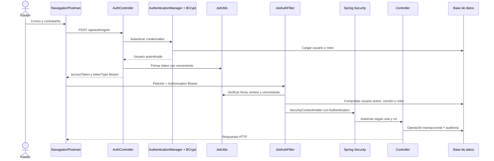

# Guion de exposición para tres integrantes

## Preparación

Ensayen con la misma base de datos y las mismas cuentas que usarán en clase. Todos los nombres de la demostración son ficticios. Inicien la aplicación antes de comenzar; si deben mostrar MySQL, utilicen el perfil correspondiente y tengan disponible el cliente de base de datos. No dependan de internet el día de la exposición: compilen y prueben antes.

Distribución sugerida para 15 minutos, ajustable al tiempo del profesor:

| Integrante | Tiempo | Responsabilidad | Evidencia |
|---|---|---|---|
| 1 | 4 minutos | Problema, arquitectura Java/Hibernate y base de datos | Modelo, entidades, claves y catálogos |
| 2 | 5 minutos | Flujo funcional, validaciones e interfaz | Paciente, reserva, reprogramación, bloqueo y reporte |
| 3 | 6 minutos | JWT, roles, auditoría y pruebas | Seis casos, errores 401/403 e historial |

Cada integrante debe poder explicar el flujo completo; la división organiza la presentación, no limita lo que debe conocer cada persona.

## Integrante 1 — Del problema al modelo

**Apertura:** “Aurora organiza la atención ambulatoria. Relacionamos pacientes, profesionales, especialidades, horarios, consultorios y citas, con acceso controlado y trazabilidad.”

1. Mostrar el resumen con datos de la base.
2. Explicar que la interfaz llama a controladores REST; los servicios verifican reglas; los repositorios usan Hibernate/JPA.
3. Mostrar `Paciente`, `Medico`, `Horario` y `Cita`. Explicar la diferencia entre una clase Java y una tabla.
4. Mostrar que un médico tiene varias especialidades mediante una relación muchos a muchos.
5. Explicar el uso de claves foráneas y unicidad de CMP, DNI y código de consultorio.
6. Abrir la base y ejecutar consultas de solo lectura:

```sql
SHOW TABLES;
SELECT id, nombre, apellido, cmp, estado FROM medicos;
SELECT * FROM medico_especialidad;
SELECT id, fecha, hora_inicio, estado, paciente_id, medico_id FROM citas;
SELECT usuario, accion, fecha_hora, tabla, registro_id FROM auditoria ORDER BY id DESC LIMIT 10;
```

**Transición:** “Con este modelo podemos reservar una cita sin separar la agenda del profesional, el paciente y el consultorio.”

## Integrante 2 — Recorrido funcional

1. Ingresar como recepción (`MODERATOR`).
2. Crear un paciente ficticio con un DNI de ocho dígitos que no exista.
3. Abrir Agenda y citas. Elegir una fecha futura, profesional, especialidad y franja libre.
4. Confirmar. Mostrar la cita en el listado y explicar que el servidor vuelve a comprobar el cupo al guardar.
5. Reprogramar a otra hora. Mostrar que se conserva la cita y cambia la franja.
6. Intentar atender una cita futura: debe rechazarse con un mensaje claro.
7. Cancelarla indicando el motivo. Mostrar el estado CANCELADA y que el cupo vuelve a quedar libre.
8. Mostrar reportes y exportar CSV.
9. Si hay tiempo, ingresar como administrador y registrar un bloqueo puntual. Mostrar que desaparece la disponibilidad afectada y reaparece al cancelarlo.

**Reglas para explicar:** no se permiten dos reservas simultáneas del mismo médico, consultorio o paciente; no se modifica un turno con citas futuras afectadas; un médico inactivo no ofrece cupos.

**Transición:** “Además de funcionar, las operaciones deben estar autorizadas y dejar evidencia de quién las realizó.”

## Integrante 3 — Seguridad y trazabilidad

Mostrar `SecurityConfig`, `JwtAuthFilter`, `JwtUtils`, `UserDetailsServiceImpl` y `AuditService`. Identificar qué valida cada clase, sin leer el código completo en voz alta.



## Los seis casos de la guía JWT

### Caso 1 — Ruta pública

`GET /api/test/all` devuelve **200**, con `{"message":"Public Content"}`. La respuesta está en `ClinicController.publicRoute()`. No exige autenticación porque `SecurityConfig.securityFilterChain()` incluye explícitamente esa ruta en `permitAll()`.

Si se retira esa excepción, la regla general para GET `/api/**` exige un rol admitido y un visitante anónimo recibe 401. `SecurityFilterChain` organiza los filtros y la política de acceso antes del controlador.

### Caso 2 — Acceso sin token

`GET /api/test/user`, sin Authorization, devuelve **401**. `JwtAuthFilter` no crea una autenticación al no encontrar un Bearer; la cadena de seguridad rechaza el acceso mediante el punto de entrada configurado. No se ejecuta `ClinicController.userRoute()`.

### Caso 3 — Token alterado

Cambiar parte del JWT y consultar `/api/test/user` devuelve **401**. `JwtUtils.validateJwtToken()` utiliza JJWT para verificar un JWT firmado. Un cambio en la firma puede producir `SignatureException`, y otros formatos inválidos producen otras subclases de `JwtException`.

`JwtAuthFilter` captura esos errores y limpia el contexto. Un token ausente no se puede validar; un token inválido sí se presenta, pero no supera la validación. Ambos carecen de autenticación válida y reciben 401 en una ruta protegida. Spring Boot no genera estos JWT por sí solo: el proyecto añade la biblioteca JJWT.

### Caso 4 — Token válido

Con un token vigente de una cuenta activa, `GET /api/test/user` devuelve **200** y `User Content`. El filtro obtiene el correo del `subject`, carga los roles actuales y crea un `UsernamePasswordAuthenticationToken`. El `SecurityContext` accesible mediante `SecurityContextHolder` guarda esa autenticación durante la solicitud.

Flujo: Postman → encabezado Authorization → JwtAuthFilter → JwtUtils → usuario/roles de base de datos → SecurityContextHolder → política de acceso → controlador. Un token vencido produce `ExpiredJwtException`, se rechaza y termina en 401. Un token revocado mediante su versión también se rechaza.

### Caso 5 — USER intenta ADMIN

Con un token válido de USER, `GET /api/test/admin` devuelve **403**. El usuario está autenticado, pero no autorizado. `requestMatchers("/api/test/admin").hasRole("ADMIN")` protege esta ruta en `SecurityConfig`; los roles del usuario se convierten en `SimpleGrantedAuthority` con el prefijo `ROLE_`.

**Autenticación** comprueba quién realiza la solicitud. **Autorización** comprueba si esa identidad puede ejecutar la acción. USER no tiene `ROLE_ADMIN`, por eso no alcanza el controlador.

### Caso 6 — ADMIN ingresa a ADMIN

Con un token vigente de ADMIN, `/api/test/admin` devuelve **200**, con `Admin Content`, generado por `ClinicController.adminRoute()`.

Se superaron firma, emisor, vencimiento, cuenta activa, versión de token y rol requerido. `SecurityContextHolder` contiene la autenticación; no guarda una contraseña en texto plano ni crea una sesión HTTP persistente. El token fue generado por `JwtUtils.generateJwtToken()` tras un inicio de sesión válido.

La interfaz Laboratorio JWT permite ejecutar peticiones reales. Para demostrar los casos 5 y 6 se debe repetir la prueba de administrador con USER y con ADMIN. Las tarjetas 5 y 6 usan la misma ruta y se ejecutan con cuentas distintas, como exige la guía. El permiso MODERATOR también se puede demostrar con /api/test/mod en Postman.

## Auditoría en vivo

Después de la reserva o reprogramación del integrante 2, abrir Auditoría como administrador. Identificar:

- Usuario que realizó la operación.
- Acción RESERVAR, REPROGRAMAR o CANCELAR.
- Fecha y hora presentada en Lima.
- Tabla `citas` e ID del registro afectado.
- Detalle del evento.

Explicar que una transacción fallida no deja un evento que afirme que se guardó correctamente. La aplicación no expone operaciones para editar el historial.

## Cinco observaciones

1. La configuración original contenía una codificación incompatible con UTF-8 y fallaba al compilar recursos. Se normalizó.
2. Una duración cero permitía un bucle infinito; los intervalos ahora tienen validación y un límite numérico de iteraciones.
3. Comprobar disponibilidad en pantalla no basta: se valida de nuevo dentro de una transacción con bloqueo de base de datos.
4. El ejemplo de registro de la guía permitía solicitar ADMIN; se restringió el registro público a USER pendiente de activación.
5. XAMPP puede incluir MariaDB en lugar de MySQL. El controlador y dialecto deben corresponder al motor; existe un perfil `xampp` específico.

## Cinco conclusiones para discutir como equipo

1. El modelo relacional permite conectar los módulos y aplicar reglas comunes de atención.
2. JWT autentica solicitudes, pero el control por roles decide qué operaciones puede realizar cada usuario.
3. La auditoría permite reconstruir cambios administrativos sin guardar contraseñas ni tokens.
4. Las pruebas de errores y concurrencia son necesarias para demostrar que el sistema protege la agenda, además de mostrar formularios exitosos.
5. Una aplicación académica funcional es un punto de partida; usar datos reales exige controles operativos, privacidad y seguridad adicionales.

Estas conclusiones deben ser comprendidas y ajustadas por el grupo según su experiencia. No sustituyen el ensayo ni afirman una calificación garantizada.

## Preguntas que conviene ensayar

- ¿Qué ocurre si dos recepcionistas reservan el mismo cupo? Una operación se confirma y la siguiente detecta el conflicto y recibe 409.
- ¿Qué diferencia hay entre 400, 401, 403, 404 y 409? Entrada inválida, falta de autenticación, falta de permiso, registro inexistente y conflicto de negocio.
- ¿Por qué no se eliminan las citas? Para conservar historial, reportes y trazabilidad.
- ¿Dónde se calcula la disponibilidad? En `ClinicService`, a partir de horarios, estados, ausencias, bloqueos y citas.
- ¿El JWT se cifra? Este proyecto firma el JWT; su contenido no debe tratarse como secreto.
- ¿Por qué cargar el usuario en cada solicitud? Para aplicar desactivaciones, cambios de roles y revocaciones de inmediato.
- ¿Qué contiene el frontend? HTML, CSS y JavaScript servidos por Spring Boot, con llamadas a la API.

## Lista de ensayo

- [ ] Las tres cuentas de demostración funcionan.
- [ ] La base elegida tiene datos ficticios y se puede consultar.
- [ ] Hay una fecha futura con cupos libres.
- [ ] Cada integrante sabe qué pantalla y clase mostrará.
- [ ] Se repitieron los seis casos en Postman o el panel JWT.
- [ ] Se comprobó la auditoría de una operación.
- [ ] El JAR está compilado y no requiere descargar dependencias en clase.
- [ ] Se revisaron los resultados de `docs/VERIFICACION.md`.
